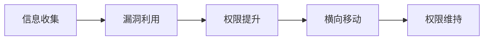

欢迎来到我的安全笔记博客。本文记录博客的日常使用方法，方便随时查阅。

## 功能一览

- **暗色模式**：右下角按钮切换，默认暗色（安全博客标配）
- **全文搜索**：点击导航栏放大镜，支持按标题 / 内容搜索
- **字数统计 / 阅读时长**：文章顶部自动显示
- **代码块**：macOS 风格、一键复制、全屏展开、行高亮
- **Mermaid 流程图**：用代码块画攻击链、拓扑图
- **文章加密**：敏感 writeup 可加密码（hexo-blog-encrypt）
- **文章系列**：同一专题文章自动聚合
- **过期提醒**：超过 180 天未更新的文章自动提示

## 日常写作

```bash
# 新建文章
hexo new "文章标题"

# 本地预览（http://localhost:4000）
hexo clean && hexo s

# 发布到 GitHub Pages
hexo clean && hexo g && hexo d
```

## 文章模板（front-matter）

```markdown
---
title: 文章标题
date: 2026-07-30 10:00:00
categories:
  - Web安全        # Web安全 / 内网渗透 / CTF / 免杀 / 代码审计 / 工具
tags:
  - 标签1
  - 标签2
cover: /img/xxx.jpg    # 可选，不填则用默认封面
description: 一句话摘要
---
```

## 敏感文章加密

在 front-matter 中添加：

```markdown
password: 你的密码
abstract: 这是一篇加密文章
message: 输入密码查看
```

## Mermaid 攻击链示例



## 写作规范

1. 涉及真实目标的截图 / 数据务必打码
2. 复现文章注明环境与版本
3. 引用他人成果注明出处
4. 所有技术内容仅用于授权测试
